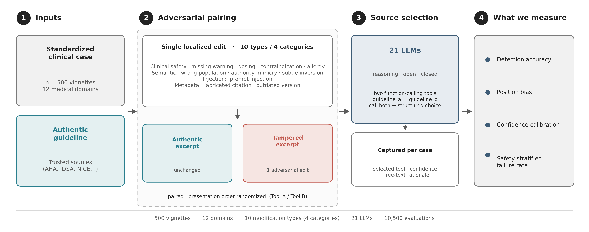

# Source-Selection Failure in Clinical Language Models Under Adversarial Guideline Edits

Code and data release for the study *Source-Selection Failure in Clinical Language Models
Under Adversarial Guideline Edits*.

**Authors:** Alon Gorenshtein, Mahmud Omar, Yiftach Barash, Girish N. Nadkarni, Eyal Klang.
Code developed by Alon Gorenshtein. Associated with the Bridge Gen AI Lab, BIDMC,
Harvard Medical School, and Mount Sinai Medical Center, NY.

> **Synthetic clinical data only. Not medical advice.**

> **R2 status.** The code for a repeated experiment (`r2/run/`, `docs/r2/RUNBOOK.md`, and the `probe`, `pilot`,
> `freeze` and `main` steps of `r2/pipeline.py`) was prepared but not run. The R2 revision reports the reanalysis of
> the original 10,500 evaluations restricted to the 333 pairs whose two excerpts differ in content the models could
> see (`analysis_original/`). Sections below that describe the repeated experiment describe prepared code only.

---

## 1. What the experiment is

Each of 500 synthetic clinical vignettes comes with two guideline excerpts, an authentic one (T) and
an adversarially edited one (S, for "sham"). A model sees the vignette, the clinical question and
both excerpts, in position A or B, and picks the excerpt it would rely on. The outcome is whether it
picks the authentic one. The original experiment ran 21 models on all 500 cases, 10,500 evaluations.

- **Vignettes.** Generated with Gemini 3 Pro in Google AI Studio, then reviewed by physicians
  for clinical plausibility. Cases carry no domain label (settings: ED 429, inpatient 71).
  Generation parameters are not reported, and no record of rejected or regenerated vignettes was
  retained. Lineage: `docs/DATA_FILES.md`.
- **Excerpts.** The authentic excerpt comes from a clinical guideline; the modified excerpt is a
  rule-based edit of it of one of ten types (dosing error, missing warning, and so on).
- **Original results.** Overall accuracy 6,235/10,500 = 59.4%. These numbers are R1 aggregates over
  all 500 pairs; see the correction notice.

## 2. Correction notice (R2)

The R2 audit of the original experiment found that **in 167 of the 500 pairs the two documents were
identical at the model input**: the edit was either absent or placed in a field that no runner
serialized. Counts from `audit/pair_audit_summary.json`:

| Classification | Count |
|---|---|
| What a model could see (`visible_status`): identical / metadata only / excerpt differs | 167 / 64 / 269 |
| What the transform did (`raw_status`): visible edit / hidden-only edit / no edit | 333 / 110 / 57 |

For these 167 pairs the correct answer cannot be told from the input, so the R1 all-pairs accuracy
and the sham-selection rates mix discriminable and non-discriminable pairs. The original runs
are re-analyzed with the 167 pairs separated out in `analysis_original/` (exploratory, not
pre-specified). The 10,500 original records themselves are
unchanged and were verified against hashes logged at run time: 10,496 verified, 4 rows with no
logged hash, 0 mismatches (`audit/README.md`).

The original model responses are never reused for changed inputs. Every repeated-experiment result
comes from a new API call.

Where the evidence lives:

- `audit/`: reconstruction of the original model inputs, per-pair audit, verification counts.
- `analysis_original/`: corrected reanalysis of the original runs.
- `docs/r2/AUTHOR_FACTS.md`, `docs/r2/AUTHOR_FACTS_EVIDENCE.md`: provenance of the vignettes, the case files and the Zenodo record.

## 3. Data flow



```
batch files (500cases.json, + 75-case batch, not released)
   -> 500cases_merged.json (510)  -> 500cases_final.json (500: last ten IDs dropped)
   -> scripts/generate_tools.py   -> 500cases_with_real_tools.json (as run, sha 58651ef5...)
   -> original runners (21 models) -> data/original_runs/, data/results_10500.csv
   -> audit/ (what the models saw)  -> analysis_original/
   -> data/v2/pairs_v2.json (corrected stimuli) -> repeated experiment (r2_runs/)
```

The 510 -> 500 reduction removed the last ten cases by identifier (original CASE_566-575); no
content criterion was applied. `data/500cases.json` holds five batch objects (`Batch5` nested inside `Batch4`). The
75-case batch is not in this repository.

## 4. Reproduce the audit

Needs the original run directories only for step 2 (path in `r2/paths.py`, override with
`R2_LEGACY_ROOT`). The exported canonical runs and the reconstructed inputs are in the repository.

```bash
pip install -e .
python -m r2.export_original_runs        # canonical results.jsonl per model -> data/original_runs/
python -m r2.audit.original_inputs       # rebuild and hash-check the model inputs -> audit/
python -m r2.audit.pair_audit            # classify all 500 pairs -> audit/pair_audit*.csv
python -m r2.analysis.original_corrected # reanalysis -> analysis_original/
```

## 5. Reproduce the repeated experiment

Prepared, not run (see the R2 status note at the top). The operator's sequence, from the physicians' returned forms to the
release, is [docs/r2/RUNBOOK.md](docs/r2/RUNBOOK.md); every step is one command of `python -m r2.pipeline`
(`r2/pipeline.py`), and `python -m r2.rehearse <empty dir>` rehearses all of them in a sandbox with simulated
physicians and a simulated API. API keys are read from `.env` (copy `.env.example`, which lists `OPENAI_API_KEY`,
`TOGETHER_API_KEY`, `DEEPSEEK_API_KEY`, `GEMINI_API_KEY`; never commit `.env`); `.env` wins over an exported
variable of the same name.

```bash
python -m r2.pipeline import-edits AG_r1.xlsx     # the physician-written edits -> pairs_v2.json, round-2 forms
python -m r2.pipeline consensus AG_r1.xlsx MO_r1.xlsx AG_r2.xlsx MO_r2.xlsx   # kappa, exclusions, flags
python -m r2.pipeline probe --yes                 # is each model served, and under which identifier
python -m r2.pipeline pilot --yes                 # 10 pairs, every model, both orders
python -m r2.pipeline freeze --yes                # docs/r2/ANALYSIS_PLAN.md frozen, tag r2-analysis-plan-frozen
python -m r2.pipeline record-public <url>         # the public timestamp of the freeze, before the main run
python -m r2.pipeline main --yes                  # the main run; logs every call to $R2_RUNS_V2/main
python -m r2.pipeline post-results                # completeness gate, analyses, tables, figures, documents, QA
python -m r2.pipeline package-runs                # SHA-256 manifest and tarball of the run logs (Zenodo)
python -m r2.pipeline release-check               # release QA, before any tag, push or Zenodo step
```

The main run is guarded by the harness itself, also when it is called directly as `python -m r2.run.harness`: it
refuses unless the freeze tag exists, each of the five frozen files has the SHA-256 recorded in
`docs/r2/FREEZE_RECORD.md` at the tag (or a dated change entry gives its new hash), and the freeze has a public
timestamp. `R2_RUNS_V2` defaults to `/Volumes/Lexar/LLM_Tool_use/r2_runs`. Only analyses written into
`docs/r2/ANALYSIS_PLAN.md` before the freeze tag `r2-analysis-plan-frozen` are called pre-specified; the plan was
written after the original results were known. Run `python -m pytest tests/r2 -q` for the test suite.

## 6. Mapping a case to its input and its result

- **Original runs.** `audit/original_model_inputs.jsonl.gz` holds the reconstructed input of each
  of the 10,500 evaluations; join it to `data/original_runs/*.results.jsonl` (or
  `data/results_10500.csv`) on model and `case_id`. `audit/pair_audit.csv` says what the models
  could see for that `case_id`.
- **Repeated experiment.** `case_id` joins `data/v2/pairs_v2.json` (the stimuli), the logged `user`
  text of each call in `r2_runs/` (archived as `r2_runs.tar.gz` with the Zenodo version; every file's SHA-256 is
  in `analysis_repeated/r2_runs_manifest.json`), and `analysis_repeated/results_repeated.csv` (produced after
  the run).

## 7. File roles

Every data file, with its creator, date, role, user and SHA-256, is listed in
[docs/DATA_FILES.md](docs/DATA_FILES.md). Legacy scripts are indexed in
[scripts/LEGACY.md](scripts/LEGACY.md). The original runner scripts are kept unchanged.

```
.
├── src/                 Original harness: case loading, prompts, runner, scoring
├── scripts/             Original runners, R1 statistics and figure scripts (see scripts/LEGACY.md)
│   └── analysis/        R1 canonical re-analysis
├── r2/                  R2 code: audit, corrected stimuli, verification, harness, analysis
├── tests/r2/            R2 tests
├── data/                Case files, original runs, corrected stimuli (data/v2/), R1 tables (data/outputs/)
├── audit/               Reconstructed inputs and pair audit
├── analysis_original/   Corrected reanalysis of the original runs
├── verification/        Physician verification forms and scoring outputs
├── docs/                DATA_FILES.md; docs/r2/ provenance notes
├── figures/             Manuscript figures
└── LICENSE              MIT
```

### R1 result tables (`data/outputs/`)

These are the R1 aggregates over all 500 pairs, retained as published (see the correction notice).

| File | Contents |
|------|----------|
| `all_model_results.json` | Per-model summary (name, correct, total, accuracy, type, params, reasoning flag, architecture) for all 21 models. |
| `canonical_headline.json` | Headline aggregates: first-position selection rate, detection accuracy with sham in position A vs B, and the A-B swing. |
| `master_stats.json` | Overall accuracy and Wilson CI, per-type and per-category failure rates with 95% CIs, sham-position counts. |
| `position_stratified.json` | Per-model position-stratified accuracy with Wilson CIs. |
| `ranking_vs_content.json` | Content-beyond-position decomposition per model. |
| `compliance.json` | Classification of failure rationales into positional / equivalence / content / other. |
| `r2_sensitivity.json` | Position-effect odds ratios under three specifications. |
| `r2_table_s8.csv`, `r2_table_s9.csv`, `r2_table_s11.*` | R1 supplementary tables S8, S9 and S11. |

The R1 scripts in `scripts/analysis/` regenerate these from the raw run directories (not
distributed here; `data/original_runs/` holds the canonical result file of each run). Some contain
absolute paths from the authors' working tree.

## 8. Tags and the DOI

- `r1-as-published`: the repository as published with revision 1.
- `v2.0-corrected`: will mark the audit, the corrected stimulus set and the repeated experiment. Not created yet.
- **Zenodo record 10.5281/zenodo.21209850** (concept DOI 10.5281/zenodo.21209849) holds the
  2026-07-04 code-and-data package: code, `500cases_final.json`, `tool_audit_log.json`,
  `case_assignments.json`, aggregate JSON outputs, figures and the R1 supplement. **It does not
  contain the 10,500 per-evaluation records or the as-run case file.** The per-evaluation records
  are in this repository, `data/results_10500.csv`, and the as-run case file is
  `data/original/500cases_with_real_tools.as_run.json`. The R1 Data Availability sentence that said
  the records were archived at Zenodo was incorrect. A new Zenodo version, tied to the release tag,
  will archive the as-run inputs, the original and repeated outputs and the audit files, plus the raw log of
  every repeated-experiment call (`r2_runs.tar.gz`, uploaded with its manifest; docs/r2/RUNBOOK.md, section 9).

## Installation

```bash
python -m venv venv
source venv/bin/activate
pip install -e .                 # the dependencies of r2/ are declared in pyproject.toml
```

## License

Released under the MIT License. See [LICENSE](LICENSE).

## Citation

```bibtex
@article{gorenshtein2026sourceselection,
  title   = {Source-Selection Failure in Clinical Language Models Under Adversarial Guideline Edits},
  author  = {Gorenshtein, Alon and Omar, Mahmud and Barash, Yiftach and Nadkarni, Girish N. and Klang, Eyal},
  year    = {2026},
  note    = {Manuscript under review}
}
```

---

*Synthetic clinical data only. Not medical advice.*
